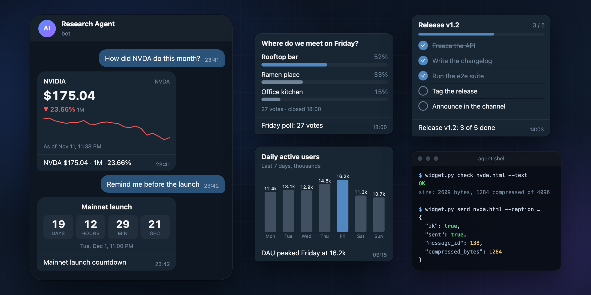
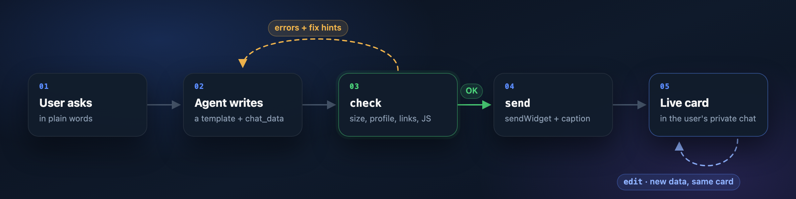
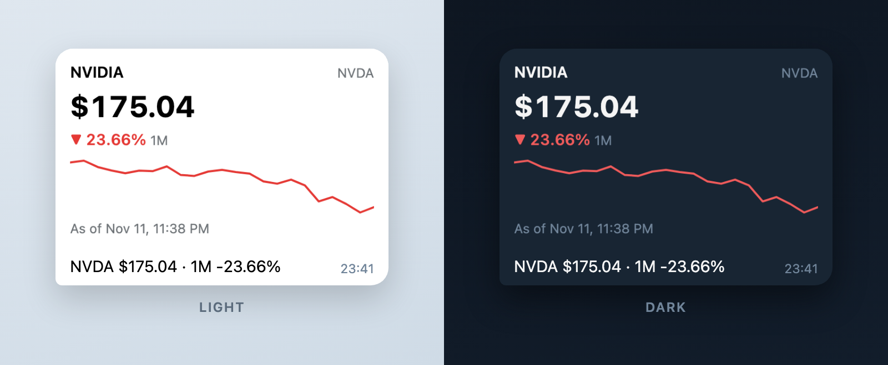

<div align="center">

# Telegram Widget Skill

**Telegram HTML widgets for AI agents. The model writes the card; a strict validator checks it before it ships.**

[](https://github.com/HappySean2845/telegram-widget-skill/actions/workflows/ci.yml)
[](https://core.telegram.org/bots/api-changelog)
[](https://github.com/NousResearch/hermes-agent)
[](https://github.com/openclaw/openclaw)
[](pyproject.toml)
[](LICENSE)

**English** · [简体中文](README.zh-CN.md)



</div>

<br>

**Telegram Widget Skill** is an open-source agent skill and CLI that lets AI agents write, validate
and send **Telegram HTML widgets**: the interactive cards bots can post inside chat messages since
[Bot API 10.4](https://core.telegram.org/bots/api-changelog) (`sendWidget`, November 2026). It
works with Hermes Agent and OpenClaw, and as a plain Python CLI with any bot.

For an agent, a widget is the difference between a paragraph of numbers and a chart the user takes
in at a glance. Widgets are also unforgiving: the Telegram app silently strips everything outside a
narrow profile, the server refuses anything over 4 KB compressed, the HTML can never be changed once
sent, and a single injected link turns a helpful card into a phishing lure.

Instead of a fixed set of cards, this skill lets the agent compose the card the conversation needs,
then holds it to Telegram's rules before it is sent: a field guide condensed from the
specification, ready-made templates, a validator that explains every problem in terms a model can
act on, and a sender that will not ship anything the validator rejects.

<sub>Not to be confused with Telegram's website widgets (Login, Post and Discussion widgets). This
project is about the widgets bots send in chats.</sub>

## Highlights

<table>
<tr>
<td width="50%" valign="top">

**🤖 Agent-native**<br>
One `SKILL.md` for both Hermes Agent and OpenClaw. Every error comes back as JSON with a rule, a
line and a fix hint, so the agent repairs its own widget before anyone sees it.

</td>
<td width="50%" valign="top">

**🛡️ Safe links by construction**<br>
Links open only to hosts the operator allowlists, written as literal URLs. Anything that could
assemble a destination at runtime is refused: if the validator cannot prove where a link goes,
the widget does not ship.

</td>
</tr>
<tr>
<td valign="top">

**📐 Built on the spec**<br>
HTML, SVG, CSS and JavaScript are checked against Telegram's widget profile, and JavaScript is
parsed by a real engine (QuickJS or Node). A widget that passes uses only what the app supports,
not whatever happens to work in a browser.

</td>
<td valign="top">

**🎯 Exact size budget**<br>
Sizes are measured the way Telegram measures them, and the result agrees with the production
server to the byte: 4,096 compressed bytes accepted, 4,097 refused.

</td>
</tr>
<tr>
<td valign="top">

**🔄 Live updates**<br>
Templates draw from `chat_data`, so a price, a vote count or a checklist updates in place with
`editMessageWidgetData` instead of flooding the chat with new messages.

</td>
<td valign="top">

**🔑 Secrets stay secret**<br>
The bot token is read from the environment and never appears in any output, error or log line,
including network failures.

</td>
</tr>
</table>

## How it works

<p align="center"></p>

## Quick start

**1. Install the skill**

```bash
# Hermes Agent
hermes skills install HappySean2845/telegram-widget-skill/

# OpenClaw
openclaw skills install git:HappySean2845/telegram-widget-skill@main
```

**2. Connect your bot.** Give the skill the token of the bot your agent already uses
(details per framework under [Installation](#installation)):

```bash
hermes config set TG_WIDGETS_BOT_TOKEN <bot token>   # Hermes Agent
```

**3. Ask for it.** Message your agent on Telegram:

> How did NVDA do this month? Show me a card.

The agent picks the price template, fills in the data, validates the widget and sends it to your
private chat. Ask again later and it updates the same card.

## Templates

Five templates ship with the skill. Each one is a single HTML file that draws from `chat_data`,
weighs in at 1 to 1.3 KB compressed, and follows the user's Telegram theme.

| Template | For |
|---|---|
| [`price-snapshot`](examples/price-snapshot.html) | A stock, token or currency: price, change and sparkline |
| [`poll-results`](examples/poll-results.html) | The outcome of a vote, with shares and a total |
| [`checklist`](examples/checklist.html) | Progress on a list of tasks |
| [`bar-chart`](examples/bar-chart.html) | A small labeled chart, one bar highlighted |
| [`countdown`](examples/countdown.html) | A ticking countdown to an event |

<p align="center"></p>

## The validator

```bash
python3 scripts/widget.py check card.html --chat-data @state.json
```

`check` prints one JSON object: `ok`, `errors` and `warnings` (each with `rule`, `message`, `line`
and a `hint`), and `stats` with the size budget. `send` runs the same check, plus the state and
the caption, and sends nothing unless everything passes.

| Area | What it enforces |
|---|---|
| Size | ≤ 32,768 bytes of UTF-8 and ≤ 4,096 bytes after `zlib.compress(html, 9)`, counted exactly like the server; valid UTF-8, no NUL; `chat_data` and `public_data` ≤ 1,024 bytes each |
| HTML and SVG | no form controls, media, iframes, external scripts or images, `data:` SVG images, presentational or focus attributes, `clipPath`, `mask`, SMIL or `foreignObject` |
| CSS | no `vh` units, scrolling overflow, sticky positioning, logical properties, multi-column layout, `oklch()` or `color-mix()`, text shadows, line clamping, 3D transforms, unsupported filters, `clip-path`, masks, blend modes, named fonts, `@font-face`, `@import`, `@container`, `@layer`, nesting, `:has()`, `:focus`, hover or print media queries, or remote `url()` |
| JavaScript | valid syntax (QuickJS, else Node, else a structural check); no network APIs, navigation, dialogs, clipboard, canvas read-back, WebGL, or touch, keyboard and scroll events |
| Links | the strict policy below |
| Limits | 2,000 nodes, 400 CSS rules, 32 `@keyframes`, 8,192 characters per attribute |

`render` goes one step further and runs the widget in headless Chromium with a Telegram-like
runtime, reporting runtime errors, the rendered height and a screenshot an agent with vision can
inspect.

## Security model

An agent reads web pages, posts and messages written by strangers. Any of them can try to talk it
into putting a malicious link into a card that looks trustworthy. The link policy is designed so
that this cannot work:

- A link is a **single literal URL** in one of four forms: `TelegramWidget.openLink('https://…')`,
  `TelegramWidget.openTelegramLink('https://t.me/…')`, `window.open('https://…')` or
  `<a href="https://…">`.
- Its host must be on the **operator's allowlist**, `TG_WIDGETS_ALLOWED_LINKS` (for example
  `example.com *.example.com t.me/YourBot`). The allowlist is **empty by default** and lives only
  in the environment, never on the command line the model writes.
- Every URL-like string anywhere in the widget, its state and its caption is checked against the
  same allowlist after escapes are decoded.
- Every way to build a name or a URL at runtime is refused: `eval`, `Function`, `.constructor`,
  `atob`, `String.fromCharCode`, `import()`, string timers, unicode escapes in identifiers, string
  concatenation of literals, computed member access on `window`, `document` or `TelegramWidget`,
  aliasing `TelegramWidget`, `innerHTML` and every other HTML-from-string API, and setting `href`,
  `src` or event handlers from code.

**Scope.** This is a guardrail for an agent that follows its skill. It is not a sandbox against
the agent itself: an agent with an unrestricted shell and the bot token can call the Bot API
directly. For that guarantee, keep the token out of the agent's shell and expose `send` as the
only route to Telegram.

## Installation

The skill needs `python3` (3.9 or newer) where the agent runs shell commands, and the token of the
bot your agent already talks through. With `quickjs` installed (`pip install quickjs`) the
JavaScript syntax check is exact; without it the validator falls back to `node --check`, then to
a structural check.

<details>
<summary><b>Hermes Agent</b></summary>

```bash
hermes skills install HappySean2845/telegram-widget-skill/
hermes config set TG_WIDGETS_BOT_TOKEN <the same token as TELEGRAM_BOT_TOKEN>
hermes config set TG_WIDGETS_ALLOWED_LINKS "example.com t.me/YourBot"   # optional
```

- Hermes deliberately removes `TELEGRAM_BOT_TOKEN` from every tool subprocess, so the skill
  declares its own variable, `TG_WIDGETS_BOT_TOKEN`, which Hermes passes through once the skill is
  loaded.
- The current chat comes from the session (`HERMES_SESSION_CHAT_ID`). `send` targets it
  automatically and refuses any other chat.
- Community skills are scanned on install; this one is rated `safe`. The installer fetches files
  through the GitHub API; if it hits the rate limit, set `GITHUB_TOKEN` or log in with `gh`.
- The skill is listed as `telegram-widgets`.

</details>

<details>
<summary><b>OpenClaw</b></summary>

```bash
openclaw skills install git:HappySean2845/telegram-widget-skill@main
```

Give the skill the bot token in `openclaw.json`:

```json
{ "skills": { "entries": { "telegram-widgets": { "apiKey": "<bot token>" } } } }
```

`apiKey` also accepts a SecretRef such as
`{"source": "env", "provider": "default", "id": "TELEGRAM_BOT_TOKEN"}`. If the gateway already has
`TELEGRAM_BOT_TOKEN` in its environment, no configuration is needed: `exec` on the gateway host
inherits it. A token that only lives in `channels.telegram.botToken` is not visible to commands.
The optional link allowlist goes in `skills.entries.telegram-widgets.env.TG_WIDGETS_ALLOWED_LINKS`.

- The model passes the chat from the turn's conversation info as is (`--chat-id telegram:123456789`).
- With `exec` in a Docker sandbox, the token and `python3` must be available inside the sandbox.
- OpenClaw's development branch adds a native `show_widget` tool. Where it is available, the
  skill validates with `check` and sends with `show_widget`.

</details>

<details>
<summary><b>Any other bot</b></summary>

The CLI is plain Python and works with any Telegram bot:

```bash
pip install "git+https://github.com/HappySean2845/telegram-widget-skill"
tgwidget check card.html
```

Or run `scripts/widget.py` from a checkout.

</details>

## CLI reference

```bash
widget.py check  card.html [--chat-data @state.json] [--text]
widget.py render card.html --out card.png [--scheme dark]
widget.py send   card.html --chat-id ID --caption TEXT [--chat-data …] [--dry-run]
widget.py edit   --chat-id ID --message-id N [--chat-data …] [--caption TEXT]
```

`widget.py` stands for `python3 scripts/widget.py` in the skill folder, or `tgwidget` after a pip install.

Every command prints one JSON object and exits with `0` (ok), `1` (refused or failed) or `2`
(usage error). Telegram errors are reported with Telegram's `description` only.

| Variable | Purpose |
|---|---|
| `TG_WIDGETS_BOT_TOKEN` | Bot token (preferred) |
| `TELEGRAM_BOT_TOKEN` | Bot token, used when the variable above is not set |
| `TG_WIDGETS_ALLOWED_LINKS` | Hosts widgets may link to, separated by spaces or commas; empty means no links |
| `TG_WIDGETS_CHAT_ID` | Default chat for standalone use |
| `TG_WIDGETS_API_BASE` | A self-hosted Bot API server instead of `https://api.telegram.org` |

## Compatibility

| Component | Version | Status |
|---|---|---|
| Telegram Bot API | 10.4 | ✅ Verified against the production servers: send, update, size limits |
| Telegram apps | | ✅ Verified in a real chat |
| Hermes Agent | v0.23.1 | ✅ Installs from GitHub, passes the install scan, token reaches the skill |
| OpenClaw | 2026.11.3 | ✅ Installs from git, ready with `python3` |
| Python | 3.9 to 3.13 | ✅ Tested in CI on every push |

The full test record is in [docs/verification.md](docs/verification.md).

## Limitations

- **Private chats only.** In production, Telegram delivers widgets only in a user's private chat
  with the bot; groups, inline mode and forwards are limited to the test environment for now.
  `send` refuses other chats unless `--test-env` is set.
- **Snapshots, not yet interactive.** A widget can call `TelegramWidget.request()`, which reaches
  the bot as a `widget_query` that must be answered within 15 seconds. Neither framework routes
  that update to skills today, so templates draw from `chat_data` and the agent refreshes them
  with `edit`.
- **Approximate preview.** `render` approximates Telegram's runtime. A browser draws things the app
  removes, so `render` complements `check` and never replaces it.
- **Older apps** show "unsupported message" with the caption instead of the widget, which is why
  every widget is sent with a caption.

## FAQ

### What are Telegram widgets?

Telegram widgets, introduced in Bot API 10.4 in November 2026, are small HTML documents a bot sends
with `sendWidget`. Telegram draws them inside the message bubble on iOS, Android, macOS, Telegram
Desktop and the web. Their JavaScript runs in a QuickJS sandbox with no network access, and the bot
changes what they show by updating their state.

### How big can a Telegram widget be?

At most 32,768 bytes of UTF-8 HTML, and at most 4,096 bytes after the server compresses it with
zlib at level 9. The chat state (`chat_data`) and the shared state (`public_data`) hold up to 1,024
bytes each. On screen a widget is 200 to 600 px wide and 50 to 600 px tall, and content beyond that
height is clipped.

### Can a widget be changed after it is sent?

Its HTML cannot. Its state can: `editMessageWidgetData` replaces `chat_data` or `public_data` and
the widget redraws, so a price card or a checklist updates in place. This skill's `edit` command
does exactly that, and can update the caption as well.

### Can bots send widgets to groups or channels?

Not in production yet. Widgets currently work only in the private chat between a user and the bot.
Groups, inline mode and forwards are available on Telegram's test server, and channels cannot
receive widgets directly at all.

### Can a widget load live data from the internet?

No. Every network API throws inside a widget, and external scripts, fonts and images are never
loaded. Data reaches a widget through its state, written by the bot, or through a request
(`TelegramWidget.request()`) that the bot answers with `answerWidgetQuery` within 15 seconds.

### How are widgets different from Telegram Mini Apps?

A Mini App is a web page you host, opened on demand in a WebView with full network access. A widget
is part of the message itself: always visible as the chat scrolls, at most 4 KB compressed, and
offline. Use a widget for a card the user takes in at a glance, and link to a Mini App with
`openTelegramLink` for anything larger.

### Which agents can use this skill?

It is packaged and tested for Hermes Agent and OpenClaw, which both read `SKILL.md`. The validator
and the sender are a plain Python CLI, so any agent that can run shell commands, or a bot you write
yourself, can use them too.

### Is it safe to let a language model write HTML for users' chats?

Telegram's sandbox keeps a widget offline and confined to its message, so the main remaining risk is
the content: an agent tricked into adding a phishing link. This skill only allows links to hosts the
operator allowlists, refuses any code that could assemble a URL at runtime, and will not send a
widget that fails these checks. See [Security model](#security-model).

## Roadmap

- [ ] Interactive widgets: answer `widget_query` through a Hermes plugin and an OpenClaw hook
- [ ] First-class support for OpenClaw's native `show_widget` once it ships in a release
- [ ] Group chats, as soon as Telegram enables widgets there in production
- [ ] More templates: leaderboards, tables, multi-series charts

## Contributing

Issues and pull requests are welcome, especially new templates and validator rules grounded in
Telegram's specification. A new rule comes with a sample that it rejects in
[`tests/test_check.py`](tests/test_check.py); a new template must pass `check` and render below
560 px at 320 px wide. The details are in [CONTRIBUTING.md](CONTRIBUTING.md). Found a way to get a
link past the validator? Please [report it privately](SECURITY.md).

```bash
python -m venv .venv && .venv/bin/pip install -e ".[dev,render]"
.venv/bin/python -m playwright install chromium
.venv/bin/pytest
```

## See also

- [Telegram's widget guide](https://core.telegram.org/bots/widgets): the specification
- [Widget Sandbox](https://github.com/TelegramMessenger/widget-sandbox): Telegram's widget runtime and profile documentation
- [Awesome Telegram Widgets](https://github.com/ADanMan/awesome-telegram-widgets): a community collection of widgets and builder tools

## Acknowledgements

The widget rules are adapted from Telegram's guide
[Telegram Widgets](https://core.telegram.org/bots/widgets.md), section "Writing widgets with an
LLM". This project is independent and not affiliated with Telegram, Nous Research or OpenClaw.

## License

[MIT](LICENSE)
