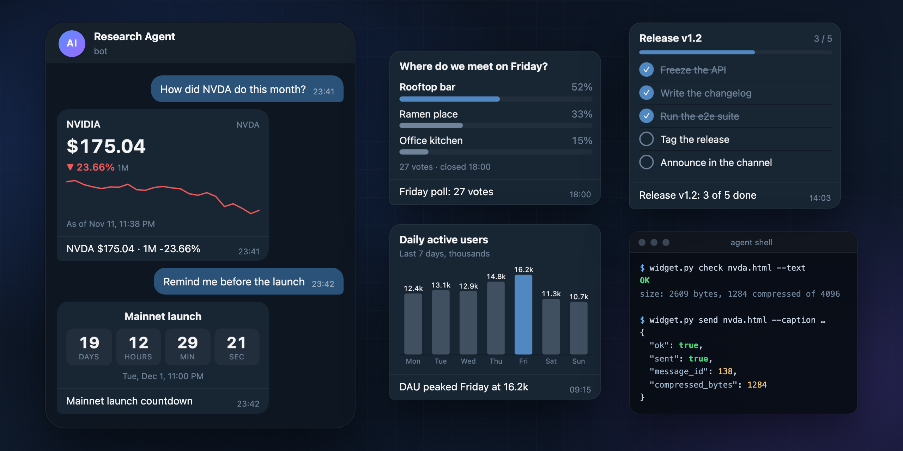
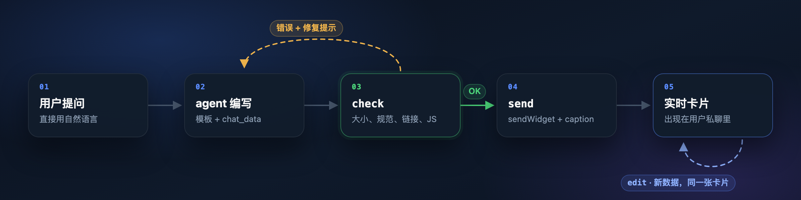
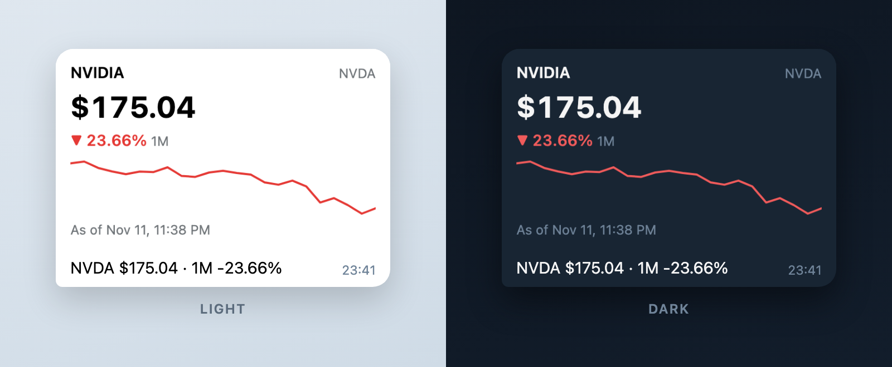

<div align="center">

# Telegram Widget Skill

**给 AI agent 用的 Telegram HTML 小组件（widget）：模型来写卡片，严格的检查器把关后才发出。**

[](https://github.com/HappySean2845/telegram-widget-skill/actions/workflows/ci.yml)
[](https://core.telegram.org/bots/api-changelog)
[](https://github.com/NousResearch/hermes-agent)
[](https://github.com/openclaw/openclaw)
[](pyproject.toml)
[](LICENSE)

[English](README.md) · **简体中文**



</div>

<br>

**Telegram Widget Skill** 是一个开源的 agent skill 和命令行工具，让 AI agent 编写、检查并发送
**Telegram HTML 小组件（widget）**：从 [Bot API 10.4](https://core.telegram.org/bots/api-changelog)
（2026 年 11 月，`sendWidget`）开始，TG bot 可以在聊天消息里发送的交互式卡片。
它支持 Hermes Agent 和 OpenClaw，也能作为普通的 Python 命令行工具配合任何 bot 使用。

对 agent 来说，widget 意味着不用再回一段堆满数字的文字，而是给用户一张一眼就能看懂的图表。
但它的规矩也很严：客户端会悄悄删掉规范以外的一切；压缩后超过 4 KB 服务器直接拒收；
HTML 发出去就再也改不了；而只要被塞进一个恶意链接，一张好用的卡片就成了钓鱼陷阱。

这个 skill 不提供一套写死的卡片，而是让 agent 按对话需要自己组织卡片，再在发出前用 Telegram 的规则把关：
一份从规范提炼的写作指南、现成的模板、一个用模型能看懂的方式指出每个问题的检查器，
以及一个检查不过就拒绝发送的发送命令。

<sub>注意区分：这里说的是 bot 在聊天里发送的 widget，不是 Telegram 网站上的登录、帖子嵌入和评论组件（Login / Post / Discussion Widget）。</sub>

## 亮点

<table>
<tr>
<td width="50%" valign="top">

**🤖 为 agent 而生**<br>
同一份 `SKILL.md` 同时支持 Hermes Agent 和 OpenClaw。每个错误都以 JSON 返回，带规则名、行号和修复提示，
agent 在用户看到之前就能自己改好。

</td>
<td width="50%" valign="top">

**🛡️ 链接安全从设计上保证**<br>
链接只能是字面量 URL，且域名必须在运营者的白名单里。任何可能在运行时拼出目标地址的写法都会被拒绝：
检查器证明不了链接去哪，widget 就发不出去。

</td>
</tr>
<tr>
<td valign="top">

**📐 以规范为准**<br>
HTML、SVG、CSS 和 JavaScript 都按 Telegram 的 widget 规范检查，JavaScript 由真正的引擎（QuickJS 或 Node）解析。
通过检查的 widget 只用客户端支持的特性，而不是碰巧在浏览器里能跑的写法。

</td>
<td valign="top">

**🎯 大小预算精确到字节**<br>
大小按 Telegram 的算法计算，和生产服务器分毫不差：压缩后 4,096 字节被接受，4,097 字节被拒。

</td>
</tr>
<tr>
<td valign="top">

**🔄 实时更新**<br>
模板从 `chat_data` 绘制，价格、票数、清单进度都通过 `editMessageWidgetData` 原地更新，不会刷屏发新消息。

</td>
<td valign="top">

**🔑 密钥不外泄**<br>
bot token 只从环境变量读取，不会出现在任何输出、报错或日志里，网络出错时也一样。

</td>
</tr>
</table>

## 工作流程

<p align="center"></p>

## 快速开始

**1. 安装 skill**

```bash
# Hermes Agent
hermes skills install HappySean2845/telegram-widget-skill/

# OpenClaw
openclaw skills install git:HappySean2845/telegram-widget-skill@main
```

**2. 接上你的 bot。** 把 agent 正在用的那个 bot 的 token 交给 skill（各框架的细节见[安装](#安装)）：

```bash
hermes config set TG_WIDGETS_BOT_TOKEN <bot token>   # Hermes Agent
```

**3. 直接开口。** 在 Telegram 里给你的 agent 发消息：

> NVDA 这个月表现怎么样？做成卡片给我看。

agent 会选用价格模板、填入数据、检查 widget，然后发到你的私聊里。之后再问，它会原地更新同一张卡片。

## 模板

skill 自带五个模板。每个都是一个独立的 HTML 文件，从 `chat_data` 绘制，压缩后只有 1 到 1.3 KB，
并跟随用户的 Telegram 主题切换浅色和深色。

| 模板 | 用途 |
|---|---|
| [`price-snapshot`](examples/price-snapshot.html) | 股票、代币或汇率：价格、涨跌幅和走势线 |
| [`poll-results`](examples/poll-results.html) | 投票结果，带占比和总票数 |
| [`checklist`](examples/checklist.html) | 一组任务的完成进度 |
| [`bar-chart`](examples/bar-chart.html) | 带标签的小柱状图，可高亮一根 |
| [`countdown`](examples/countdown.html) | 实时跳动的事件倒计时 |

<p align="center"></p>

## 检查器

```bash
python3 scripts/widget.py check card.html --chat-data @state.json
```

`check` 输出一个 JSON 对象：`ok`、`errors` 和 `warnings`（每条都有 `rule`、`message`、`line` 和 `hint`），
以及记录大小预算的 `stats`。`send` 会跑同样的检查，外加状态数据和 caption，全部通过才发送。

| 方面 | 检查内容 |
|---|---|
| 大小 | UTF-8 不超过 32,768 字节，`zlib.compress(html, 9)` 后不超过 4,096 字节，算法和服务器一致；必须是合法 UTF-8，不含 NUL；`chat_data` 和 `public_data` 各不超过 1,024 字节 |
| HTML 和 SVG | 不能有表单控件、音视频、iframe、外部脚本或图片、`data:` 形式的 SVG 图片、表现类或焦点类属性、`clipPath`、`mask`、SMIL 或 `foreignObject` |
| CSS | 不能用 `vh` 系列单位、滚动溢出、sticky 定位、逻辑属性、多列布局、`oklch()` 或 `color-mix()`、文字阴影、行数截断、3D 变换、不支持的 filter、`clip-path`、mask、混合模式、具名字体、`@font-face`、`@import`、`@container`、`@layer`、嵌套、`:has()`、`:focus`、hover 或 print 媒体查询、远程 `url()` |
| JavaScript | 语法正确（QuickJS，其次 Node，都没有就做结构检查）；不能用网络 API、页面跳转、弹窗、剪贴板、canvas 回读、WebGL，以及触摸、键盘和滚动事件 |
| 链接 | 见下文的严格策略 |
| 上限 | 2,000 个节点、400 条 CSS 规则、32 个 `@keyframes`、每个属性 8,192 个字符 |

`render` 更进一步：在无头 Chromium 里用模拟的 Telegram 运行环境跑一遍 widget，报告运行时错误、
实际高度，并输出一张截图，带视觉能力的 agent 可以直接看图检查。

## 安全模型

agent 每天都在读陌生人写的网页、帖子和消息，其中任何一条都可能试图诱导它把恶意链接放进一张看起来很可信的卡片。
链接策略的设计目标，就是让这种诱导无从得手：

- 链接只能是**一个字面量 URL**，并且只有四种写法：`TelegramWidget.openLink('https://…')`、
  `TelegramWidget.openTelegramLink('https://t.me/…')`、`window.open('https://…')` 或 `<a href="https://…">`。
- 域名必须在**运营者的白名单** `TG_WIDGETS_ALLOWED_LINKS` 里（例如 `example.com *.example.com t.me/YourBot`）。
  白名单**默认为空**，而且只从环境变量读取，永远不出现在模型写的命令行里。
- widget、状态数据和 caption 里任何像 URL 的字符串，都会先解码转义，再过同一份白名单。
- 所有能在运行时拼出名字或 URL 的写法一律拒绝：`eval`、`Function`、`.constructor`、`atob`、
  `String.fromCharCode`、`import()`、字符串定时器、标识符里的 unicode 转义、字面量字符串拼接、
  在 `window`、`document` 或 `TelegramWidget` 上做计算属性访问、给 `TelegramWidget` 起别名、
  `innerHTML` 及其他一切从字符串生成 HTML 的 API，以及在代码里设置 `href`、`src` 或事件处理器。

**适用范围。** 这是给「按 skill 办事的 agent」装的护栏，不是针对 agent 本身的沙箱：
一个有不受限 shell 和 bot token 的 agent 完全可以直接调用 Bot API。如果需要这层保证，
就别把 token 放进 agent 的 shell，只把 `send` 作为通往 Telegram 的唯一途径。

## 安装

agent 执行 shell 命令的环境里需要 `python3`（3.9 或更高），以及 agent 正在使用的那个 bot 的 token。
装了 `quickjs`（`pip install quickjs`）后 JavaScript 语法检查是精确的；没装就退回 `node --check`，
再没有就做结构检查。

<details>
<summary><b>Hermes Agent</b></summary>

```bash
hermes skills install HappySean2845/telegram-widget-skill/
hermes config set TG_WIDGETS_BOT_TOKEN <和 TELEGRAM_BOT_TOKEN 相同的 token>
hermes config set TG_WIDGETS_ALLOWED_LINKS "example.com t.me/YourBot"   # 可选
```

- Hermes 会刻意把 `TELEGRAM_BOT_TOKEN` 从每个工具子进程里删掉，所以 skill 声明了自己的变量
  `TG_WIDGETS_BOT_TOKEN`，skill 加载后 Hermes 会把它传进来。
- 当前聊天来自会话（`HERMES_SESSION_CHAT_ID`），`send` 自动发往这里，并拒绝发往其他聊天。
- Hermes 安装社区 skill 时会做安全扫描，本 skill 的评级是 `safe`。安装器通过 GitHub API 下载文件，
  如果碰到限流，设置 `GITHUB_TOKEN` 或用 `gh` 登录即可。
- skill 在列表里显示为 `telegram-widget-skill`。

</details>

<details>
<summary><b>OpenClaw</b></summary>

```bash
openclaw skills install git:HappySean2845/telegram-widget-skill@main
```

在 `openclaw.json` 里把 bot token 交给 skill：

```json
{ "skills": { "entries": { "telegram-widget-skill": { "apiKey": "<bot token>" } } } }
```

`apiKey` 也可以写成 SecretRef，例如 `{"source": "env", "provider": "default", "id": "TELEGRAM_BOT_TOKEN"}`。
如果 gateway 的环境变量里已经有 `TELEGRAM_BOT_TOKEN`，就什么都不用配：gateway 主机上的 `exec` 会继承它。
只写在 `channels.telegram.botToken` 里的 token 对命令不可见。可选的链接白名单写在
`skills.entries.telegram-widget-skill.env.TG_WIDGETS_ALLOWED_LINKS`。

- 模型把本轮对话信息里的 chat 原样传入（`--chat-id telegram:123456789`）。
- 如果 `exec` 跑在 Docker 沙箱里，token 和 `python3` 都要在沙箱内可用。
- OpenClaw 的开发分支新增了原生的 `show_widget` 工具。在有这个工具的版本里，skill 用 `check` 检查，
  用 `show_widget` 发送。

</details>

<details>
<summary><b>其他任意 bot</b></summary>

命令行工具是纯 Python，任何 Telegram bot 都能用：

```bash
pip install "git+https://github.com/HappySean2845/telegram-widget-skill"
tgwidget check card.html
```

也可以在仓库里直接运行 `scripts/widget.py`。

</details>

## 命令参考

```bash
widget.py check  card.html [--chat-data @state.json] [--text]
widget.py render card.html --out card.png [--scheme dark]
widget.py send   card.html --chat-id ID --caption TEXT [--chat-data …] [--dry-run]
widget.py edit   --chat-id ID --message-id N [--chat-data …] [--caption TEXT]
```

`widget.py` 指 skill 目录下的 `python3 scripts/widget.py`，pip 安装后也可以用 `tgwidget`。

每个命令都输出一个 JSON 对象，退出码为 `0`（成功）、`1`（被拒或失败）或 `2`（用法错误）。
Telegram 报错时只返回 Telegram 的 `description`。

| 环境变量 | 作用 |
|---|---|
| `TG_WIDGETS_BOT_TOKEN` | bot token（优先使用） |
| `TELEGRAM_BOT_TOKEN` | bot token，上一个变量没设置时使用 |
| `TG_WIDGETS_ALLOWED_LINKS` | widget 允许链接的域名，用空格或逗号分隔；为空表示不允许任何链接 |
| `TG_WIDGETS_CHAT_ID` | 单独使用命令行时的默认聊天 |
| `TG_WIDGETS_API_BASE` | 本机（`localhost`）上自建的 Bot API 服务器，代替 `https://api.telegram.org`；其他主机一律拒绝，因为 token 会发给它 |

## 兼容性

| 组件 | 版本 | 状态 |
|---|---|---|
| Telegram Bot API | 10.4 | ✅ 已在生产服务器上验证：发送、更新、大小上限 |
| Telegram 客户端 | | ✅ 已在真实聊天中验证 |
| Hermes Agent | v0.23.1 | ✅ 可从 GitHub 安装，通过安装扫描，token 能传到 skill |
| OpenClaw | 2026.11.3 | ✅ 可从 git 安装，有 `python3` 即就绪 |
| Python | 3.9 到 3.13 | ✅ 每次推送都在 CI 中测试 |

完整的测试记录见 [docs/verification.md](docs/verification.md)（英文）。

## 已知限制

- **只支持私聊。** 生产环境下，Telegram 只在用户和 bot 的私聊里展示 widget；群聊、inline 模式和转发目前仅限测试环境。
  除非加 `--test-env`，`send` 会拒绝发往其他聊天。
- **目前是快照，还不能交互。** widget 可以调用 `TelegramWidget.request()`，它会以 `widget_query` 的形式到达 bot，
  并且必须在 15 秒内回复。目前两个框架都不会把这个更新转给 skill，所以模板从 `chat_data` 绘制，由 agent 用 `edit` 刷新。
- **预览是近似的。** `render` 模拟的是 Telegram 的运行环境。浏览器能画出客户端会删掉的东西，
  所以 `render` 只是 `check` 的补充，不能代替它。
- **旧版客户端**会显示「unsupported message」加上 caption，而不是 widget，所以每个 widget 发送时都必须带 caption。

## 常见问题

### Telegram 的 widget（小组件）是什么？

Telegram widget 是 2026 年 11 月随 Bot API 10.4 推出的功能：bot 用 `sendWidget` 发送一份小型 HTML 文档，
Telegram 在 iOS、Android、macOS、Telegram Desktop 和网页版上把它画在消息气泡里。
它的 JavaScript 跑在不能联网的 QuickJS 沙箱里，bot 通过更新状态数据来改变它显示的内容。

### Telegram widget 最大能多大？

UTF-8 的 HTML 最多 32,768 字节，服务器用 zlib level 9 压缩后最多 4,096 字节。
聊天状态（`chat_data`）和共享状态（`public_data`）各最多 1,024 字节。
显示时宽 200 到 600 px、高 50 到 600 px，超出高度的部分会被裁掉。

### widget 发出去之后还能改吗？

HTML 不能改，状态可以：`editMessageWidgetData` 替换 `chat_data` 或 `public_data` 后 widget 会重绘，
所以价格卡、清单都能原地更新。本 skill 的 `edit` 命令做的就是这件事，还能顺带改 caption。

### bot 能把 widget 发到群里或频道吗？

生产环境暂时不行。目前 widget 只能发在用户和 bot 的私聊里；群聊、inline 模式和转发只在 Telegram 的测试服务器上开放，
频道则完全不能直接接收 widget。

### widget 能联网拉实时数据吗？

不能。widget 里所有网络 API 都会抛错，外部脚本、字体和图片一律不加载。
数据只能通过 bot 写入的状态送进来，或者由 widget 发起请求（`TelegramWidget.request()`），
bot 在 15 秒内用 `answerWidgetQuery` 回复。

### widget 和 Telegram 小程序（Mini App）有什么区别？

小程序是你自己托管的网页，按需在 WebView 里打开，可以随意联网。
widget 是消息本身的一部分：随聊天滚动始终可见，压缩后不超过 4 KB，并且完全离线。
一眼能看完的卡片用 widget，更复杂的内容用 `openTelegramLink` 跳转到小程序。

### 哪些 agent 能用这个 skill？

它按 Hermes Agent 和 OpenClaw 的规范打包并实测过，两者都读取 `SKILL.md`。
检查器和发送命令本身是普通的 Python 命令行工具，所以任何能执行 shell 命令的 agent，
或者你自己写的 bot，也都能用。

### 让大模型写 HTML 发到用户聊天里安全吗？

Telegram 的沙箱让 widget 无法联网、也出不了自己的消息，剩下的主要风险在内容上：agent 被诱导塞进钓鱼链接。
本 skill 只允许链接到运营者白名单里的域名，拒绝任何能在运行时拼出 URL 的代码，检查不通过就不发送。
详见[安全模型](#安全模型)。

## 路线图

- [ ] 可交互的 widget：通过 Hermes 插件和 OpenClaw 钩子回复 `widget_query`
- [ ] OpenClaw 原生 `show_widget` 正式发布后，提供一等支持
- [ ] Telegram 在生产环境开放群聊 widget 后，第一时间支持
- [ ] 更多模板：排行榜、表格、多序列图表

## 参与贡献

欢迎提 issue 和 pull request，尤其是新模板，以及有 Telegram 规范依据的检查规则。
新规则要在 [`tests/test_check.py`](tests/test_check.py) 里附上一个会被它拒绝的样例；
新模板必须通过 `check`，并且在 320 px 宽时渲染高度不超过 560 px。细则见 [CONTRIBUTING.md](CONTRIBUTING.md)（英文）。
如果发现了能把链接绕过检查器的办法，请[私下报告](SECURITY.md)。

```bash
python -m venv .venv && .venv/bin/pip install -e ".[dev,render]"
.venv/bin/python -m playwright install chromium
.venv/bin/pytest
```

## 相关资源

- [Telegram 的 widget 指南](https://core.telegram.org/bots/widgets)：官方规范
- [Widget Sandbox](https://github.com/TelegramMessenger/widget-sandbox)：Telegram 的 widget 运行环境和 profile 文档
- [Awesome Telegram Widgets](https://github.com/ADanMan/awesome-telegram-widgets)：社区整理的 widget 和开发工具合集

## 致谢

widget 规则改编自 Telegram 的指南 [Telegram Widgets](https://core.telegram.org/bots/widgets.md)
中「Writing widgets with an LLM」一节。本项目独立开发，与 Telegram、Nous Research、OpenClaw 均无关联。

## 许可证

[MIT](LICENSE)
