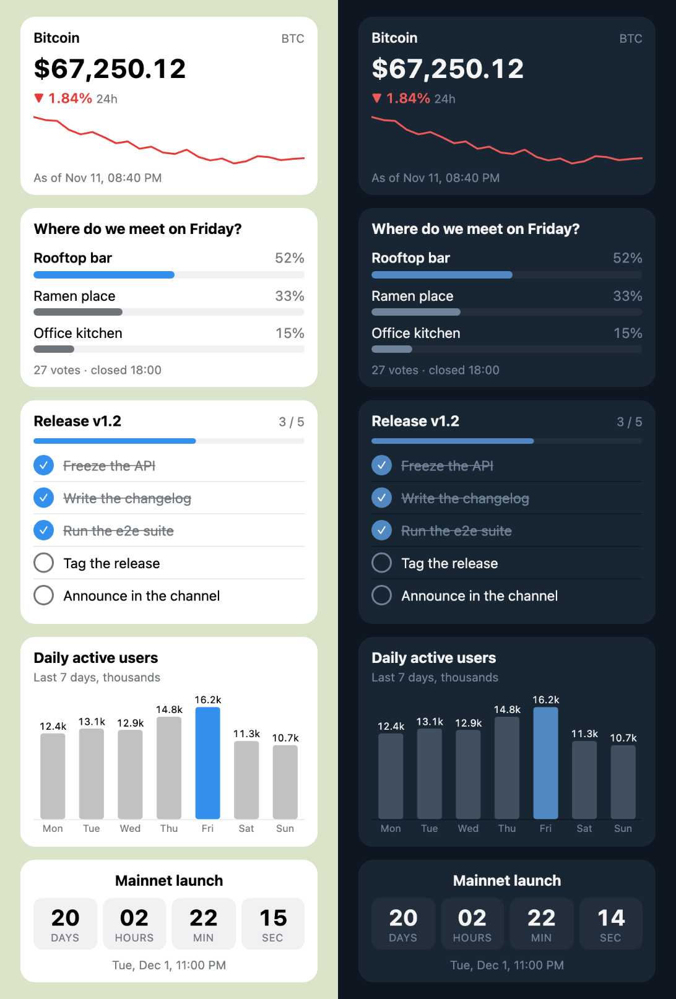

# telegram-widget-skill

[English](README.md) | **简体中文**

让你的 Telegram AI agent 在聊天里画 **HTML widget**：行情卡、投票结果、待办清单、小图表、倒计时。
agent 写好 widget，先过一遍严格的检查器，通过了才用 Telegram 的 `sendWidget` 发出去。

可以作为 **[Hermes Agent](https://github.com/NousResearch/hermes-agent)** 和
**[OpenClaw](https://github.com/openclaw/openclaw)** 的 skill 使用（两者读的是同一份 `SKILL.md`），
其他 bot 也能直接当命令行工具用。

<p align="center"></p>

## 为什么要做这个

2026 年 11 月 9 日，Telegram 发布了 [Bot API 10.4](https://core.telegram.org/bots/api-changelog)：
bot 可以发 widget 了。widget 是一份自包含的 HTML，在所有 Telegram 客户端的消息气泡里运行。
模型写 HTML 很在行，但 widget 有几个容易踩的坑：

- 客户端会**悄悄删掉**「widget profile」以外的一切（不支持 `vh`、输入框、`position: sticky`、
  网络请求、外链图片……），所以在浏览器里看着没问题的 widget，到了 Telegram 里可能是坏的；
- 服务器拒收 **zlib 压缩后超过 4096 字节**的 widget，而且 HTML **发出去以后就不能再改**；
- 模型读过一个网页或一条推文，就可能被诱导把**钓鱼链接**塞进一张好看的卡片，用户一点就中招。

这个 skill 给 agent 提供规则、一个返回机器可读错误（agent 能照着改）的检查器，
以及一个检查不通过就拒绝发送的发送命令。

## skill 里有什么

仓库根目录就是 skill 目录（OpenClaw 从 git 安装时要求 `SKILL.md` 在根目录）。

```
SKILL.md                    agent 什么时候用 widget、怎么用
references/widget-rules.md  给模型看的精简版 widget 规则
examples/*.html, *.json     五个从 chat_data 画出来的 widget，带示例状态
scripts/widget.py           命令行工具（Python 3.9+，只用标准库）
scripts/tgwidget/           它的代码
```

```bash
python3 scripts/widget.py check  card.html --chat-data @state.json   # 检查，输出 JSON
python3 scripts/widget.py render card.html --out card.png             # 可选：用无头 Chromium 渲染
python3 scripts/widget.py send   card.html --chat-id 123 --caption "BTC $67,250" --chat-data @state.json
python3 scripts/widget.py edit   --chat-id 123 --message-id 456 --chat-data @new-state.json
```

bot token 优先读 `TG_WIDGETS_BOT_TOKEN`，没有再读 `TELEGRAM_BOT_TOKEN`。任何输出里都不会出现 token：
出错时只返回 Telegram 的 `description`，从不返回 HTTP 库的报错信息
（那里面带着请求 URL，而 URL 里就有 token）。

## 检查器

`check` 输出一个 JSON 对象：`ok`、`errors`、`warnings`（每条都有 `rule`、`message`、
`line`，以及告诉模型怎么改的 `hint`）和 `stats`（大小、剩余额度）。
`send` 会跑同样的检查（外加状态数据和 caption），不通过就什么都不发。

| 方面 | 检查内容 |
|---|---|
| 大小 | UTF-8 不超过 32768 字节，`zlib.compress(html, 9)` 后不超过 4096 字节（算法和服务器一致），不含 NUL，必须是合法 UTF-8；`chat_data`/`public_data` 各不超过 1024 字节 |
| HTML / SVG | 不能有表单控件、音视频、iframe、`<script src>`、远程图片、`data:` 形式的 SVG 图片、表现类或焦点类属性、`clipPath`/`mask`/SMIL/`foreignObject` 等 |
| CSS | 不能用 `vh` 系列单位、`overflow: auto/scroll`、`position: sticky`、逻辑属性、多列布局、`oklch()`/`color-mix()`、`text-shadow`、行数截断、3D 变换、blur/brightness/drop-shadow 以外的 filter、`clip-path`、mask、混合模式、具名字体、`@font-face`/`@import`/`@container`/`@layer`、嵌套、`:has()`/`:focus`、`@media (hover/pointer/print)`、远程 `url()` |
| JavaScript | 语法检查（优先 QuickJS，其次 Node，都没有就做结构检查）；不能用网络 API、页面跳转、弹窗、剪贴板、canvas 回读、WebGL、触摸/键盘/滚动事件 |
| **链接** | 见下文 |
| 上限 | 2000 个节点、400 条 CSS 规则、32 个 `@keyframes`、每个属性 8K 字符（`data:` 图片 URL 也算在内） |

### 链接：证明不了链接去哪，就拒绝整个 widget

- 打开链接只能用**一个字面量 URL**，并且只有四种写法：
  `TelegramWidget.openLink('https://…')`、`TelegramWidget.openTelegramLink('https://t.me/…')`、
  `window.open('https://…')` 或 `<a href="https://…">`。
- 域名必须在**运营者的白名单** `TG_WIDGETS_ALLOWED_LINKS` 里
  （`example.com`、`*.example.com`、`t.me/YourBot`）。**默认为空，也就是不允许任何链接。**
  没有对应的命令行参数，因为命令行是模型写的。
- 任何位置出现的像 URL 的文本（字符串、属性、正文、CSS、状态数据、caption），
  先解码转义（`'https://…'` 就是 `https://…`），再过同一份白名单。
- 一切能把名字或 URL 拼出来的写法都拒绝：`eval`、`Function`、`.constructor`、`atob`、
  `String.fromCharCode`、`import()`、字符串参数的定时器、标识符里的 unicode 转义、
  `'a' + 'b'` 这样的字面量拼接、用字符串键或在 `window`/`document`/`TelegramWidget` 上做计算属性访问、
  把 `TelegramWidget` 传来传去、`innerHTML` 及其他一切从字符串生成 HTML 的 API、在代码里设置 `href`/`src`/`on*`。

**威胁模型。** 这是给「按 skill 办事的 agent」装的护栏：让它读到的内容没法引导它发出钓鱼卡片。
它不是针对 agent 本身的沙箱：一个有不受限 shell 和 bot token 的 agent 完全可以直接调 Bot API。
如果需要这层保证，就别把 token 放进 agent 的 shell，只把 `send` 暴露为通往 Telegram 的唯一途径。

## 安装

两个框架读的是同一份 `SKILL.md`。agent 执行 shell 命令的那台机器上需要有 `python3`（3.9+），
还需要 agent 正在用的那个 bot 的 token。装上 `quickjs`（`pip install quickjs`）后 JavaScript
语法检查是精确的；没装就退回 `node --check`，再没有就做结构检查。

### Hermes Agent

```bash
hermes skills install HappySean2845/telegram-widget-skill/
hermes config set TG_WIDGETS_BOT_TOKEN <和 TELEGRAM_BOT_TOKEN 相同的 token>
hermes config set TG_WIDGETS_ALLOWED_LINKS "example.com t.me/YourBot"   # 可选：widget 允许链接的域名
```

- Hermes 会故意把 `TELEGRAM_BOT_TOKEN` 从每个工具子进程的环境变量里删掉，skill 也没法要回来。
  所以这个 skill 声明了自己的变量 `TG_WIDGETS_BOT_TOKEN`，skill 加载后 Hermes 会把它传给终端。
- 发给哪个聊天由会话决定：Hermes 把当前 chat id 放进终端环境变量（`HERMES_SESSION_CHAT_ID`），
  `send` 直接用它。`--chat-id` 指向别的聊天会被拒绝。
- Hermes 安装社区 skill 时会做安全扫描，这个 skill 的结论是 `safe`。安装时会通过 GitHub API
  逐个文件下载仓库，大约要一分钟；如果卡在 API 限流上，设置 `GITHUB_TOKEN` 或用 `gh` 登录。
- skill 显示名为 `telegram-widgets`（目录名跟随仓库名）。

### OpenClaw

```bash
openclaw skills install git:HappySean2845/telegram-widget-skill@main
```

然后把 bot token 交给 skill，可以写成 `openclaw.json` 里这个 skill 的 key：

```json
{ "skills": { "entries": { "telegram-widgets": { "apiKey": "<bot token>" } } } }
```

（`apiKey` 也可以写成 SecretRef，比如 `{"source": "env", "provider": "default", "id": "TELEGRAM_BOT_TOKEN"}`），
如果 gateway 的环境变量里已经有 `TELEGRAM_BOT_TOKEN`，那什么都不用配：gateway 主机上的 `exec` 会继承它。
如果 token 只写在 `channels.telegram.botToken` 里，命令是看不到的，这时要设置 `apiKey`。
链接白名单（可选）：`skills.entries.telegram-widgets.env.TG_WIDGETS_ALLOWED_LINKS`。

- 模型把本轮对话信息里的 chat 原样传进来（`--chat-id telegram:123456789`），`send` 能识别这种格式。
- 如果 `exec` 跑在 Docker 沙箱里，宿主机上的 token 和 `python3` 在里面都没有。
- OpenClaw 的 `main` 分支（截至 2026-11-11 还没发版）自带一个 `show_widget` 工具，
  需要打开 `channels.telegram.widgets: true`，它还会把点击回传给 agent。
  在那个版本里，skill 会让模型先用本 skill `check`，再用 `show_widget` 发送。

### 其他 bot

命令行工具就是普通 Python：`pip install "git+https://github.com/HappySean2845/telegram-widget-skill"`
之后就有 `tgwidget check|render|send|edit`，或者在仓库里直接跑 `scripts/widget.py`。

## 限制和后续计划

- **正式环境的 widget 只能发在和 bot 的私聊里。** 群聊、inline 模式和转发目前只在测试服务器可用；
  `send` 会拒绝非私聊的 chat id，除非加 `--test-env`。
- **还不支持交互请求。** widget 可以调用 `TelegramWidget.request()`，它会以 `widget_query`
  更新的形式到达 bot，并且必须在 15 秒内回复。目前没有哪个 skill 能回复它：Hermes 根本收不到这个更新
  （它订阅的是 python-telegram-bot 的更新类型列表，那份列表比 widget 早）；OpenClaw 2026.11.3
  及之前的版本没订阅它；OpenClaw 的 `main` 分支会自己用空数据回复所有 `widget_query`，
  只把它自己 `show_widget` 发出的 widget 的点击转给 agent。所以 v1 的 widget 都是从 `chat_data`
  画出来的快照，agent 用 `edit`（`editMessageWidgetData`）更新它们。`--allow-queries`
  是留给自己会处理 `widget_query` 的 bot 用的。下一步：做一个订阅并回复 `widget_query` 的
  Hermes 插件，OpenClaw 也做同样的钩子。
- render 检查只是近似 Telegram 的默认样式；浏览器能画出 Telegram 会删掉的东西，
  所以 `render` 是 `check` 的补充，不能代替它。
- 哪些 Telegram 客户端版本支持 widget 官方没有公布；不支持的客户端会显示
  「unsupported message」加上 caption，这就是 `send` 强制要求 caption 的原因。

## 测试情况

| | 状态 |
|---|---|
| 检查器和命令行 | 149 个测试：所有示例、一组合格 widget、每条规则各一个不合格 widget（链接、动态代码、profile、大小） |
| `send` / `edit` | 对着本地的假 Bot API：请求内容、发送前拒绝、Telegram 报错、网络错误、输出里永远没有 token |
| 渲染 | 示例在无头 Chromium 里渲染，浅色和深色，320 px 宽时高度都在 560 px 以内 |
| OpenClaw 2026.11.3 | 从本仓库 `skills install git:…`，`skills info` 显示就绪，依赖 `python3`，主环境变量为 `TG_WIDGETS_BOT_TOKEN`；装好的命令行工具能用 macOS 自带的 Python 3.9 运行 |
| Hermes Agent v0.23.1 | `skills install HappySean2845/telegram-widget-skill/` 通过安装扫描（`safe`）；skill 能正确加载目录和所需变量；`hermes config set` 之后 `TG_WIDGETS_BOT_TOKEN` 能进终端子进程，`TELEGRAM_BOT_TOKEN` 进不去 |
| 真实 Telegram 客户端 | 还没有 |
| 在任一框架里跑完整一轮 agent 对话 | 还没有 |

## 开发

```bash
python -m venv .venv && .venv/bin/pip install -e ".[dev,render]"
.venv/bin/python -m playwright install chromium
.venv/bin/pytest
```

## 致谢

widget 规则改编自 Telegram 的指南
[Telegram Widgets](https://core.telegram.org/bots/widgets.md) 中「Writing widgets with an LLM」一节。
本项目与 Telegram、Nous Research、OpenClaw 均无关联。

MIT 许可证。
